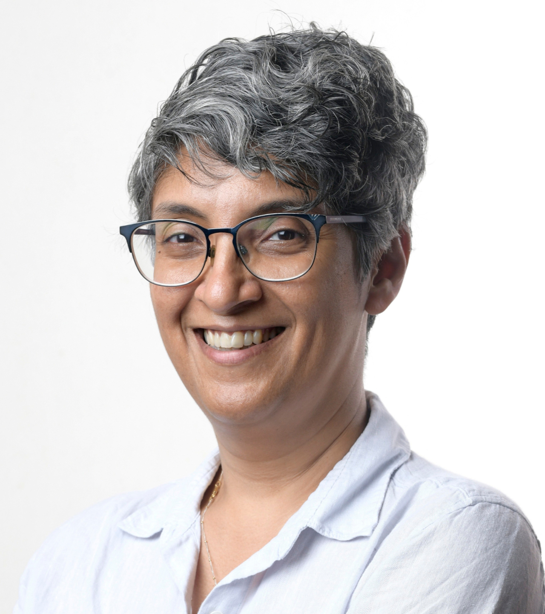

::::: {.hero}
{.headshot width=192px}

::: {.hero-text}
I am an economist.

[Google Scholar](https://scholar.google.com/citations?user=0QRD90YAAAAJ&hl=en) · [RePEc](https://ideas.repec.org/e/pth170.html) · [ORCID](https://orcid.org/0000-0003-3124-6671) · [Email](mailto:sthomas.entp@gmail.com)
:::
:::::

## Recent research {.section}

:::{#recent-papers}
:::

[All research →](research.qmd)

## Now reading {.section}

The Masani Reading Group meets to discuss one book each quarter.

:::{#current-book}
:::

[All past books and notes →](reading.qmd)
